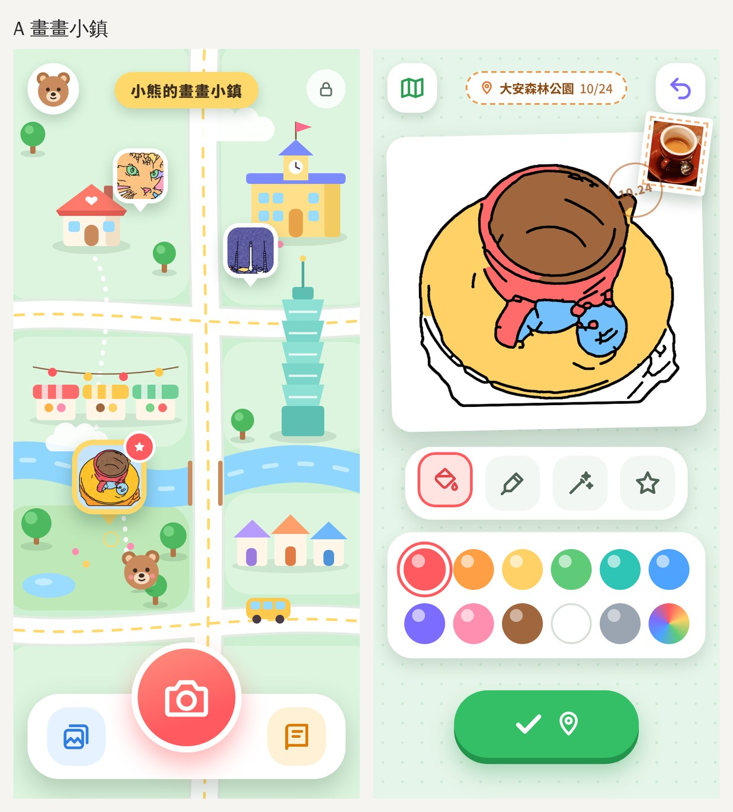
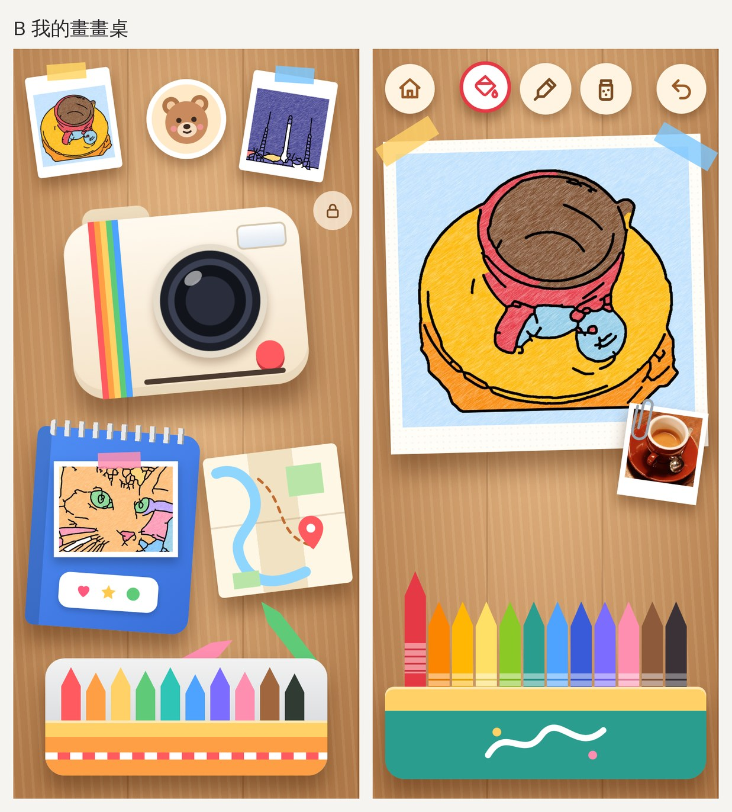
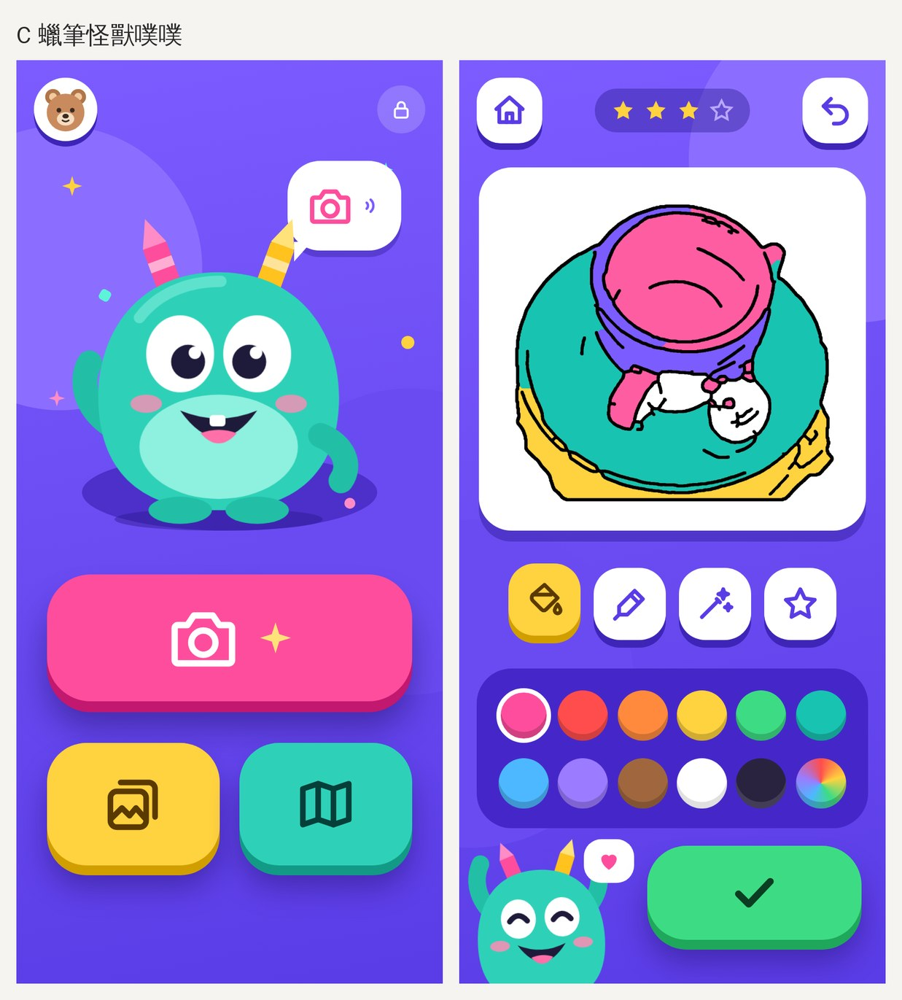

# 介面方向提案（v3 候選）

v2「3D 玩具風」看起來像套版：通用的表情符號圖示放在白色方塊上，而且 APP 最特別的兩件事（照片變著色頁、城市地圖日誌）在畫面上都看不到。下面是三個完全不同的方向，請選一個或混搭。

圖裡的線稿是原型引擎（`prototypes/lineart`）真的產生的，顏色是模擬小朋友塗的。

## A｜畫畫小鎮
首頁就是小朋友自己的城市地圖。每張畫完成後變成一個圖釘，插在拍照的地方。著色畫面像寫明信片，上面有地點和日期郵戳。
- 優點：地圖日誌變成主角，這是別的著色 APP 沒有的。
- 參考：Toca Life World、Sago Mini World 的地圖式首頁。

## B｜我的畫畫桌
一張木頭畫畫桌：拍立得相機（拍照）、素描本（作品集）、摺起來的地圖（地圖日誌）、一盒蠟筆。塗出來有真的蠟筆紋理。
- 優點：最有質感，最像實體玩具。
- 參考：Pok Pok 的手作玩具感、Crayola 的真實畫具。

## C｜蠟筆怪獸噗噗
一隻蠟筆怪獸當主角，會說話、揮手、眨眼，著色時在旁邊加油。顏色飽和，按鈕又大又胖。
- 優點：角色最鮮明，最容易做成品牌和社群素材。
- 參考：Duolingo、Khan Academy Kids 用角色帶動整個 APP。

