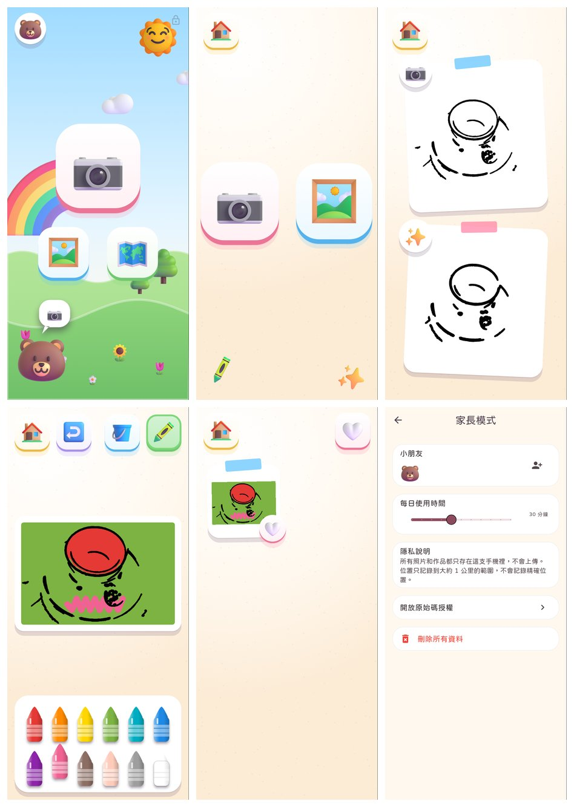
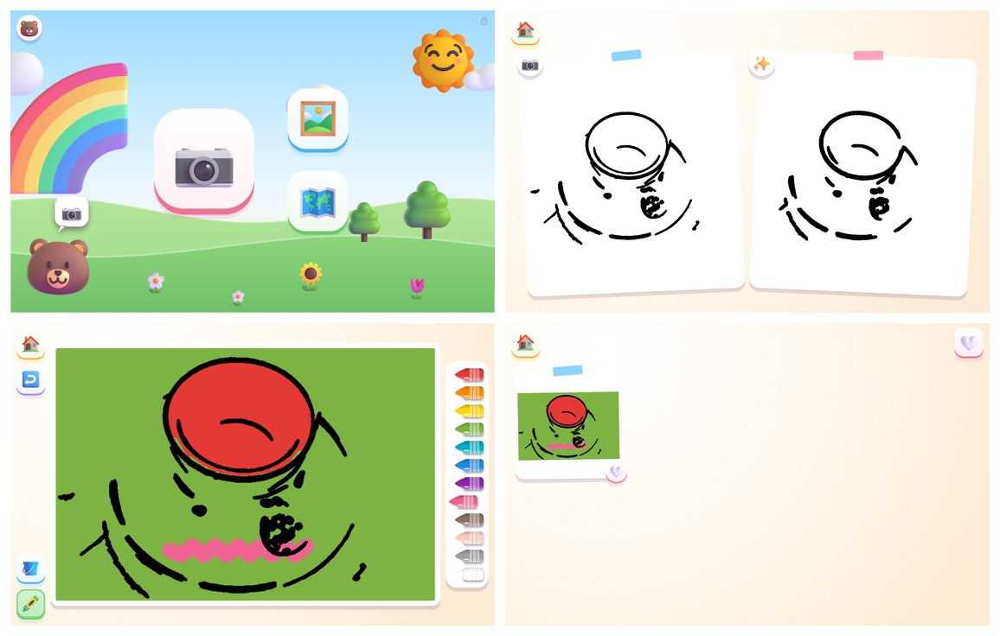

# 視覺設計：3D 玩具風 v2

給 2.5–5 歲小朋友：**整個 APP 像一盒可以摸的立體玩具**。畫面上沒有要讀的字，小朋友自己的動物會帶路。

v1「繪本貼紙風」看起來太簡陋，v2 參考了 Pok Pok、Toca Boca、Crayola、Bimi Boo、Yateland 等已上架的 APP，研究筆記見 [design-references.md](design-references.md)。

## 設計原則
| 原則 | 做法 | 參考 |
|---|---|---|
| 摸得到的玩具 | 按鈕是白色「玩具方塊」：有彩色厚邊和柔和陰影；按下會被壓扁再彈回 | Pok Pok |
| 角色帶路 | 小朋友選的 3D 動物站在首頁山丘上，用對話框指著相機 | Toca Boca |
| 選擇很少 | 首頁 3 個、拍照 2 個、風格 2 個；主要動作最大，並且會輕輕「呼吸」 | Toca Boca |
| 像真的美術用品 | 工具是油漆桶、蠟筆的 3D 圖；調色盤是一盒立體蠟筆，選到的那支會跳出來 | Crayola |
| 完成要慶祝 | 畫完回首頁時，畫面噴出彩帶、拉炮和星星 | Yateland |
| 作品像寶貝 | 作品集像貼在牆上的照片：微微傾斜、貼紙膠帶、愛心收藏 | |
| 有生命的場景 | 首頁有彩虹、會飄的雲、會晃的太陽、樹和花；按鈕依序彈出 | Sago Mini |
| 家長畫面另成一格 | 家長模式是簡潔的白色卡片，以文字為主 | |

## 設計元素
- **插圖**：Microsoft Fluent Emoji 3D（MIT 授權，可商用），放在 `app/assets/illustrations/`。授權全文在 APP 的「家長模式 → 開放原始碼授權」。
- **字型**：jf open 粉圓 2.1（justfont，SIL OFL 1.1，可商用）。
- **配色**（`lib/app/theme.dart` 的 `KidColors`）

| 名稱 | 色碼 | 用途 |
|---|---|---|
| paper 紙 | `#FFF8EE` | 背景 |
| ink 墨 | `#4A3B47` | 家長畫面的文字 |
| berry 莓果粉 | `#FF7FA3` | 主要動作（拍照）、收藏 |
| sun 向日葵黃 | `#FFC94D` | 回首頁 |
| sky 天空藍 | `#5CC2FF` | 作品集、油漆桶 |
| grass 草綠 | `#7DD87A` | 地圖、魔法蠟筆 |
| lavender 薰衣草紫 | `#B79CFF` | 復原 |

- **元件**（`lib/app/`）

| 元件 | 用途 |
|---|---|
| `ToyButton` | 玩具方塊按鈕（方形或圓形），可選中、可呼吸 |
| `Pressable` | 按下壓扁、放開彈回的手感 |
| `ToyCard` | 白色卡片，可以傾斜、貼紙膠帶 |
| `AvatarBadge`、`ArtBadge` | 小朋友的 3D 動物頭像、裝飾小圓章 |
| `SpeechBubble` | 角色的對話框（裡面放圖，不放字） |
| `PopIn` | 依序彈出的進場動畫 |
| `BouncingDots` | 等待中動畫，用來代替文字 |
| `Celebration` | 完成時的彩帶慶祝 |
| `SceneBackground` | 首頁、地圖的立體場景 |
| `PaperBackground` | 其他畫面的暖色紙背景 |
| `CrayonTray` | 立體蠟筆盒 |
| `Art`、`ArtImage` | 3D 插圖清單與顯示 |

- **尺寸**：
  - 主要按鈕約為螢幕短邊的 44%（150–250 dp）
  - 工具按鈕 76 dp
  - 插圖佔按鈕的 66%

## 版面
- **手機直向**：工具在上方，畫紙在中間，蠟筆盒在下方（兩排、每排 6 支，不需要滑動）。
- **平板橫向**：工具在左側，畫紙在中間，蠟筆盒在右側（直排一列）。

## 之後要做
- 正式上架前請插畫家設計專屬角色、APP 圖示，取代 Fluent Emoji。
- 按鈕音效、完成音效、國語語音嚮導。
- 主題範本庫、解鎖新筆刷／貼紙當獎勵。
- 截圖由自動測試產生（`app/test/flow_test.dart`），每次推送後可在 GitHub Actions 的 `app-screenshots` 下載；iPhone／iPad 模擬器截圖在 `ios-simulator-screenshots`。
