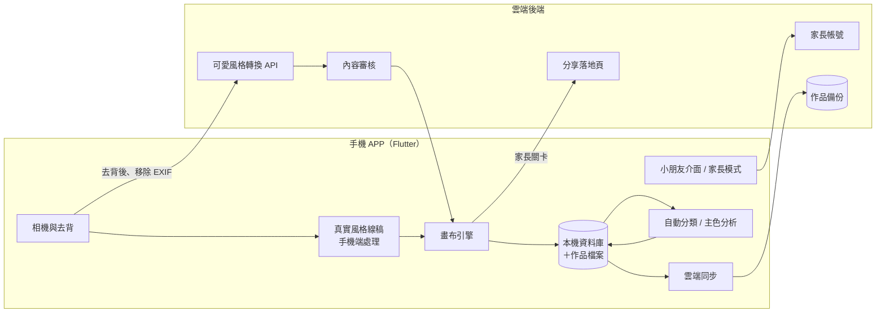

# 技術架構建議 v0.1

對應功能規劃：[product-plan.md](product-plan.md)。以下為建議方案，第 0 階段技術驗證後再定案。

---

## 1. 跨平台框架：建議 Flutter

| 選項 | 優點 | 缺點 |
|---|---|---|
| **Flutter（建議）** | 一套程式碼同時支援 Android 與 iOS；自繪畫布效能好，適合筆刷與油漆桶這類大量像素運算；相機、ML、地圖、分享都有現成套件 | 要學 Dart 語言 |
| React Native＋Skia | 熟悉 JavaScript／TypeScript 的人上手快 | 高效能畫布需要較多調校 |
| 原生（Kotlin＋Swift） | 效能與系統整合最好 | 要寫兩套，成本約兩倍，不建議 |

---

## 2. 系統架構



---

## 3. 線稿轉換管線

### 3.1 真實風格（手機端、可離線）
1. **主體去背**：Android 用 ML Kit Subject Segmentation，iOS 用 Vision 前景遮罩（iOS 17 以上）；透過 Flutter platform channel 呼叫原生 API。
2. **前處理**：縮放到約 1024–2048 px、降噪（雙邊濾波）、顏色量化，讓色塊變大、雜訊變少。
3. **線條萃取**：XDoG 或 Canny 邊緣偵測（OpenCV）；若品質不夠，再改用線稿萃取的 ML 模型（TFLite／Core ML）。
4. **後處理**：移除小雜點、形態學閉合補缺口、線條加粗、合併過小的區塊。
5. **輸出**：
   - 白底黑線 PNG（線稿圖層）
   - **區塊標籤圖（region map）**：每個封閉區塊一個編號，給油漆桶與「不出界」模式使用。

「細緻度滑桿」實際上是調整模糊程度、門檻值與最小區塊面積。

### 3.2 可愛風格（雲端）
1. 手機端先去背、縮圖、**移除 EXIF**。
2. 上傳後端 → 輸入內容審核 → 生成式 AI 圖生圖（提示方向：可愛 Q 版、粗線條、著色本風格、白底黑線、無陰影）→ 再跑一次 3.1 的後處理 → 輸出審核 → 回傳。
3. **處理完立即刪除原圖**，不保留。
4. 每位使用者有額度控管，避免費用失控。
5. **AI 供應商要能替換**：用轉接層（adapter）封裝，因為各家價格與品質變動很快。

---

## 4. 畫布引擎

**圖層（由下到上）**
| 圖層 | 內容 |
|---|---|
| L0 背景 | 白紙或紙紋 |
| L1 顏色 | 小朋友塗的顏色 |
| L2 線稿 | 以 multiply 疊加，鎖定不可編輯 |
| L3 貼紙 | 印章、貼紙 |

**實作重點**
- 每一筆都存成向量資料（座標點、壓力、筆刷、顏色、時間）→ 支援復原、縮時重播、換解析度重繪。
- **油漆桶**直接查 region map 填色：速度快，也不會漏色。
- **不出界模式**：從 region map 取出觸碰到的區塊當遮罩（clip mask）。
- 蠟筆、色鉛筆用紋理印章式筆刷（stamp-based）；水彩用多層半透明疊加加上模糊。

---

## 5. 資料模型（初稿）

```text
Child        小朋友檔案
  id, name, avatar, birthYear?, createdAt

Place        地點（模糊化）
  id, childId, type(auto|home|school|park|custom),
  label, district, geohash6, createdAt

Artwork      作品
  id, childId, placeId?, createdAt, updatedAt,
  style(realistic|cute|template),
  detailLevel, lineWidth,
  originalPhotoPath?, lineArtPath, regionMapPath,
  coloredPath, thumbnailPath, strokesPath,
  voiceNotePath?, tags[], dominantColors[],
  isFavorite, isCompleted, sharedAt?, syncState
```

- 位置只存 **geohash 前 6 碼**（約 1 公里內的範圍）與行政區名稱，**精確座標不寫入任何儲存**。
- 行政區名稱用系統反向地理編碼取得（Android Geocoder／iOS CLGeocoder）。

---

## 6. 本機儲存
- **資料庫**：SQLite（建議用 drift 套件），存作品 metadata 與搜尋索引。
- **檔案**：原圖、線稿、region map、成品、筆畫資料（壓縮）分開存放。
- **縮圖快取**：作品集與地圖圖釘使用。

---

## 7. 後端：建議 Firebase（MVP 最快）

| 服務 | 用途 |
|---|---|
| Authentication | 家長登入（Apple／Google／Email） |
| Firestore | 帳號、小朋友檔案、作品 metadata |
| Cloud Storage | 作品圖片備份 |
| Cloud Functions | 可愛風格轉換、內容審核、額度控管 |
| Hosting | 分享落地頁，以及 Universal Links／App Links 設定 |

- 替代方案：Supabase（開源、以 PostgreSQL 為基礎）。
- iOS 若提供 Google 等第三方登入，依 App Store 規範需同時提供隱私友善的登入選項（通常就是 Sign in with Apple）。
- **數據分析**：兒童類別限制第三方分析工具。若需要分析，只收最少量、去識別化的資料，上架前逐一確認 SDK 是否符合 Apple 與 Google 的兒童規範。

---

## 8. 地圖
- **MapLibre GL**（開源、免費，Flutter 套件 `maplibre_gl`）搭配**自訂可愛樣式**：粉嫩配色、圓潤道路、隱藏大部分文字標籤。
- 圖資：OpenStreetMap 衍生的圖磚服務（多數有免費額度），或用 Mapbox Studio 設計樣式。
- 圖釘：作品縮圖做成圓形貼紙，距離近的自動聚合成一疊。

---

## 9. 自動分類與顏色搜尋
- **自動分類**：ML Kit Image Labeling（手機端，Android 與 iOS 都可用）→ 對應到 10–15 個兒童友善分類。
- **主色分析**：對成品做顏色量化（k-means）取 3 個主色 → 對應到調色盤上的顏色，用於「依顏色找」。

---

## 10. 分享
- 系統分享選單：`share_plus` 套件。
- 圖卡合成：成品＋三格前後對照＋浮水印＋QR code。
- 縮時影片：重播筆畫資料逐格輸出，用原生影片編碼 API（Android MediaCodec／iOS AVAssetWriter）轉成 MP4。
- 分享前一律移除 EXIF。

---

## 11. Git、CI/CD 與上架

**Git 分支**
- `main`：穩定版本
- `feature/*` 或 `claude/*`：開發中的功能，完成後合併回 `main`

**注意事項**
- **金鑰、簽章檔、API key 不可 commit**，改用 GitHub Secrets。
- `.gitignore` 要排除建置產物與任何使用者資料。

**CI/CD**
- GitHub Actions：程式碼檢查、單元測試、Android 建置。
- iOS 建置需要 macOS：GitHub Actions 的 macOS runner 或 Codemagic；簽章可用 Fastlane match 管理。

**上架所需帳號與費用**
| 項目 | 費用 |
|---|---|
| Apple Developer Program | US$99／年 |
| Google Play Console | US$25（一次性） |
| Mac 電腦 | iOS 建置與上架需要（或使用雲端 macOS） |
| AI 生成與雲端服務 | 依用量計費；初期多半在免費額度內 |

---

## 12. 建議專案目錄（Flutter）

```text
lib/
  app/              路由、主題、多語系
  features/
    capture/        拍照、去背
    lineart/        線稿轉換
    canvas/         畫布、筆刷、圖層
    gallery/        作品集、搜尋
    map_journal/    地圖日誌
    share/          分享、圖卡、影片
    parent/         家長模式、家長關卡
  core/             資料庫、檔案儲存、同步、ML 服務
backend/            Cloud Functions
docs/               規劃文件
```
