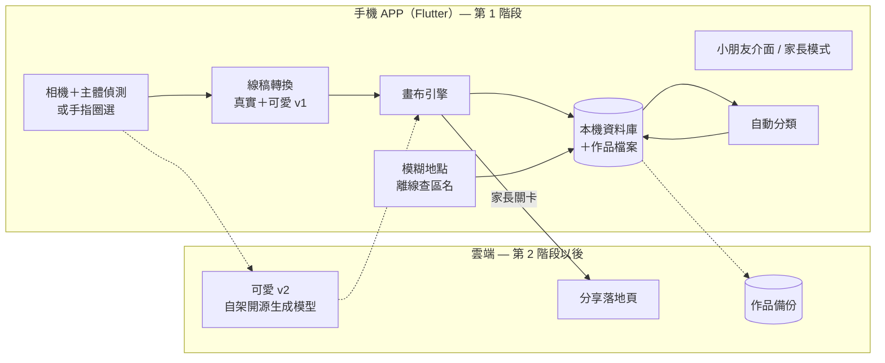

# 技術架構建議 v0.2

對應功能規劃：[product-plan.md](product-plan.md)。
已確認：**Android 先行**、目前沒有 Mac、先用開源／免費方案、台灣市場。

---

## 1. 跨平台框架：Flutter

| 選項 | 優點 | 缺點 |
|---|---|---|
| **Flutter（採用）** | 一套程式碼同時支援 Android 與 iOS；自繪畫布效能好；**在 Linux／Windows 就能開發 Android 版**，iOS 之後再用雲端建置 | 要學 Dart 語言 |
| React Native＋Skia | 熟悉 JavaScript 的人上手快 | 高效能畫布需要較多調校 |
| 原生（Kotlin＋Swift） | 效能最好 | 要寫兩套，而且 Swift 開發需要 Mac |

---

## 2. 系統架構

**第 1 階段完全離線：沒有伺服器、沒有帳號。** 隱私最安全，也不用花錢養伺服器。



---

## 3. 線稿轉換

Python 原型與測試結果：[prototypes/lineart](../prototypes/lineart/README.md)。

### 3.1 真實風格（手機端、可離線）：開源線條偵測模型
第一版「色塊分區法」不會漏色，但線條是色塊交界，不像原圖。現在改成**線條忠於照片、塗色區塊另外計算**：

1. **找主角**：
   - Android 用 ML Kit Subject Segmentation，iOS 用 Vision 前景遮罩
   - 失敗時讓小朋友用手指圈選，再用 GrabCut 做精細去背
2. **構圖**：
   - 主角佔照片 10% 以上：去背、裁切放大，頁面比例維持在 3:4 到 4:3 之間
   - 否則保留整個畫面（例如發射台上的火箭），不去背
3. **線條偵測**：DexiNed（MIT 授權，OpenCV Zoo 提供 ONNX 檔），輸出每個像素是線條的機率。
4. **整理線條**：
   - 去掉背景的線
   - 用雙門檻（hysteresis）保留連得上強線條的弱線條
   - 形態學閉合補小斷點，再細化成中心線，去掉太短的線
   - 重新畫成粗細一致、抗鋸齒的線條
5. **完整外框**（只畫主角時）：用去背輪廓畫外框，並刪掉緊貼外框的模型線條，避免出現雙線。
6. **塗色區塊圖（region map）**：
   - 把線條加粗到能封住小缺口，取剩下的區塊當種子
   - 再用 watershed 長回真正的線條
   - 這樣缺口處會形成看不見的邊界，油漆桶不漏色，畫面上的線條也不必為了封閉而變形
7. **細緻度**：調整線條門檻、最短線長、線條粗細與補缺口的距離。

**移植到 APP**：
- 影像處理步驟用 `opencv_dart`（OpenCV 原生綁定），在背景 isolate 執行，不卡畫面。
- 模型用 ONNX Runtime Mobile 或轉成 TFLite 執行。
- DexiNed 約 47 MB，要先量化壓縮，並在中低階 Android 手機上實測。太慢的話，改用同作者的輕量模型 TEED（MIT 授權）。
- 細化（skeletonize）在 OpenCV 有對應的 `ximgproc.thinning`。

### 3.2 可愛風格 v1（手機端、零成本，原型已完成）
以 3.1 的真實線稿為基礎，所以認得出是同一個東西：
- 用更嚴格的門檻，只留最明顯、最長的線
- 線條加粗，再用模糊＋門檻把轉角和抖動「融」成圓潤的卡通線
- 細節擠在一起融成黑塊的地方，只保留外緣，變成一個可以塗的形狀
- 只畫主角時：加上貼紙風外框，背景放星星、愛心（都是可以塗的封閉區塊）
- 整個畫面時不加裝飾，以免貼到主角身上
- 表情（眼睛、微笑、腮紅）**預設不加**，在 APP 裡做成貼紙讓小朋友自己選

### 3.3 可愛風格 v2（第 2 階段以後，自架開源模型）
- **模型**：Stable Diffusion 系列（SD 1.5／SDXL）＋ControlNet 線稿控制＋可愛著色本風格的 LoRA。
- **授權檢查（重要）**：
  - SD 1.5、SDXL 採 OpenRAIL 授權，允許商用但有使用限制
  - **避開非商用授權的模型**，例如 FLUX.1 [dev]、AnimeGAN
  - 每個 LoRA 的授權都要逐一確認
- **成本**：開源模型免授權費，但**需要 GPU 才跑得動**。可以選擇：
  - 自有電腦（NVIDIA 顯示卡）：長期最便宜
  - 按秒計費的雲端 GPU：初期用量少時比較划算
- **手機端直接生成**：目前對多數手機還太重，日後再評估。
- **流程**：
  1. 手機先去背、縮圖、移除 EXIF
  2. 上傳 → 內容審核 → 生成 → 套用 3.1 的後處理，確保區塊封閉 → 回傳
  3. 伺服器不保留照片
- **AI 供應商要能替換**：模型和主機都用轉接層包起來。
- **原型結果**（`prototypes/lineart/cute_gen.py`）：
  - 用照片線稿當 ControlNet 骨架、LCM 6 步，杯子、貓、火箭都畫成認得出來的 Q 版
  - 模型畫的是扁平上色卡通，再用 DexiNed 描成線稿
  - 伺服器 CPU 每張約 1–2 分鐘，正式上線一定要用 GPU
  - 提示詞中的「主角是什麼」由手機端圖片辨識（ML Kit Image Labeling）自動提供

---

## 4. 畫布引擎

**圖層（由下到上）**
| 圖層 | 內容 |
|---|---|
| L0 背景 | 白紙或紙紋 |
| L1 顏色 | 小朋友塗的顏色 |
| L2 線稿 | 以 multiply 疊加，鎖定不可編輯 |
| L3 貼紙 | 印章、貼紙 |

**實作重點**
- 每一筆都存成向量資料（座標點、壓力、筆刷、顏色、時間）→ 支援復原、縮時重播、換解析度重繪。
- **油漆桶**直接查 region map 填色：速度快，也不會漏色。
- **魔法蠟筆（不出界）**：從 region map 取出第一下碰到的區塊當遮罩。
- 蠟筆用紋理印章式筆刷；亮粉用粒子＋閃爍動畫。
- 雙指縮放預設關閉；手掌誤觸偵測。

---

## 5. 資料模型（初稿）

```text
Child        小朋友檔案
  id, avatar, createdAt          （不存姓名與生日也能運作）

Place        地點（模糊化）
  id, childId, type(auto|home|school|park|grandparents|custom),
  district, geohash6, createdAt

Artwork      作品
  id, childId, placeId?, createdAt, updatedAt,
  style(realistic|cute|template), detailLevel,
  originalPhotoPath?, lineArtPath, regionMapPath,
  coloredPath, thumbnailPath, strokesPath,
  voiceNotePath?, tags[], dominantColors[],
  isFavorite, isCompleted, sharedAt?
```

- 位置只存 **geohash 前 6 碼**（約 1 公里內的範圍）與行政區名稱，**精確座標不寫入任何儲存**。
- **行政區名稱離線查詢**：內建政府資料開放平臺的「鄉鎮市區界線」資料，在手機上直接判斷位置屬於哪個區，位置不必傳給任何服務。

---

## 6. 本機儲存
- **資料庫**：SQLite（`drift` 套件），存作品資料與搜尋索引。
- **檔案**：原圖、線稿、region map、成品、筆畫資料（壓縮）分開存放在 APP 私有目錄。
- **縮圖快取**：作品集與地圖圖釘使用。

---

## 7. 後端（第 2 階段才需要）

第 1 階段不需要後端。第 2 階段需要雲端備份與分享落地頁時，建議用：

| 服務 | 用途 |
|---|---|
| Firebase Authentication | 家長登入（Google／Apple／Email） |
| Firestore＋Cloud Storage | 作品資料與圖片備份 |
| Cloud Functions | 額度控管、呼叫可愛 v2 的 GPU 主機 |
| Hosting | 分享落地頁，以及 App Links／Universal Links |

- 替代方案：Supabase（開源，可以自架）。
- iOS 若提供 Google 等第三方登入，依 App Store 規範需同時提供隱私友善的登入選項（通常就是 Sign in with Apple）。
- **數據分析**：兒童類別限制第三方分析工具。若需要分析，只收最少量、去識別化的資料，上架前逐一確認。

---

## 8. 地圖（第 2 階段）
- **MapLibre GL**：開源、免費，Flutter 套件 `maplibre_gl`。
- **自訂可愛樣式**：粉嫩配色、圓潤道路、隱藏大部分文字標籤。
- **幼兒版限制**：只開放幾個固定縮放層級，不能自由拖曳。
- **圖資**：OpenStreetMap 衍生的圖磚服務（台灣的圖資相當完整，多數服務有免費額度）。
- **圖釘**：作品縮圖做成圓形貼紙，距離近的自動聚合成一疊。

---

## 9. 自動分類
- **ML Kit Image Labeling**（手機端、免費，Android 與 iOS 都可用）→ 對應到 4–6 個兒童分類泡泡。
- **主色分析**（家長版顏色搜尋）：對成品做顏色量化，取 3 個主色。

---

## 10. 分享
- 系統分享選單：`share_plus` 套件。台灣以 LINE 為主，FB、IG 也走系統分享選單。
- 圖卡合成：成品＋三格前後對照＋浮水印＋QR code。
- 縮時影片：重播筆畫資料並逐格輸出，用原生影片編碼 API（Android MediaCodec／iOS AVAssetWriter）轉成 MP4。
- 分享前一律移除 EXIF。

---

## 11. 沒有 Mac 的開發與上架方式

| 項目 | Android | iOS |
|---|---|---|
| 開發 | Linux／Windows 都可以（目前在雲端開發環境進行） | 程式碼和 Android 共用 |
| 建置 | GitHub Actions（Linux 機器） | 雲端 macOS：Codemagic 或 GitHub Actions 的 macOS 機器 |
| 實機測試 | 安裝 APK，或用 Google Play 封閉測試 | 需要 Apple 開發者帳號，用 TestFlight 安裝 |
| 上架帳號 | Google Play Console（US$25，一次性） | Apple Developer Program（US$99／年） |

- iOS 簽章用 App Store Connect API Key＋Fastlane match 自動處理，**全程不需要 Mac**。
- 免費的建置分鐘數有限，macOS 機器消耗特別快，只在要發 iOS 測試版時才建置。

**Git 與機密**
- `main`：穩定版本；`claude/*`、`feature/*`：開發中，完成後合併回 `main`。
- **金鑰、簽章檔、API key 不可 commit**，改用 GitHub Secrets（`.gitignore` 已排除常見的簽章檔）。

---

## 12. 專案目錄

```text
prototypes/lineart/   第 0 階段的線稿轉換原型（Python）＋測試結果
app/                  Flutter APP（第 1 階段骨架已建立，說明見 app/README.md）
  lib/
    app/              外殼：路由（go_router）、主題、大按鈕元件、繁中文字
    core/             資料層：drift 資料庫、作品資料夾、repositories、Riverpod providers
    features/
      home/           首頁、切換小朋友
      capture/        拍照、選相簿
      lineart/        轉換引擎介面（可替換）、簡易引擎、塗色區塊圖、風格選擇
      canvas/         著色畫布：油漆桶、魔法蠟筆、復原、自動儲存
      gallery/        作品集、我的最愛
      map_journal/    地圖日誌（佔位，第 2 階段）
      parent/         家長關卡、家長模式
  test/               自動測試（區塊圖、著色、家長關卡、資料庫、引擎、首頁）
.github/workflows/    GitHub Actions：檢查、測試、建置 Android APK
docs/                 規劃文件
```

**套件版本**（第 1 階段骨架）
- Flutter 3.47.8（Dart 3.13）
- flutter_riverpod 3、go_router 18、drift 2.35、image_picker、image

**尚未加入**：分享（share_plus）、定位、DexiNed 引擎移植、語音、使用時間提醒、內建著色圖庫。
