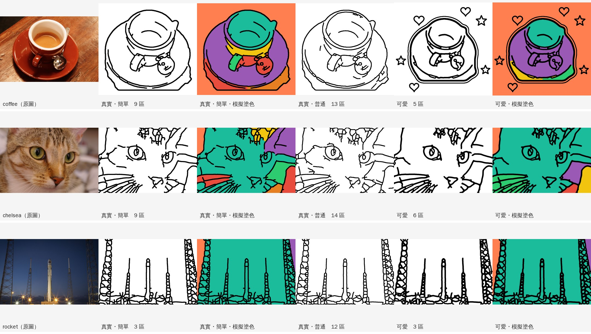

# 第 0 階段：線稿轉換原型

驗證整個 APP 風險最大的部分：**照片能不能變成 2.5–5 歲小朋友塗得開心的著色圖**。



## 真實風格：開源 AI 線條偵測

第一版用「色塊分區」，雖然不會漏色，但線條是色塊的邊界，**看起來不像原本的照片**。
第二版改用開源的邊緣偵測模型 **DexiNed**（MIT 授權，可以商用），描出照片真正的輪廓：

1. **決定構圖**：
   - **只畫主角**：主角佔照片一定比例時（杯子、玩具、寵物），去背並放大到填滿畫面
   - **整個畫面**：主角只佔照片一小部分時（例如發射台上的火箭），保留整個場景，才看得出「火箭要升空」
   - 原型用 GrabCut 去背；APP 裡會用手機內建的主體偵測（Android ML Kit、iOS Vision），或讓小朋友 **用手指把東西圈起來**
2. **AI 描輪廓**：DexiNed 找出照片中的線條，例如杯緣、把手、湯匙、貓的眼睛、鼻子、鬍鬚、發射塔。
3. **整理成著色本線條**：
   - 去掉背景的線（例如木紋）
   - 補起小斷點，去掉太短的雜線
   - 統一成粗細一致、圓滑的線條
   - 只畫主角時，外框改用去背的輪廓，**整圈完整不斷**
4. **不漏色**：線條忠於照片，難免有小缺口。所以另外計算「塗色區塊圖」：在缺口處設一條看不見的邊界，油漆桶倒下去就不會漏到外面。

| 細緻度 | 適合 | 線條 |
|---|---|---|
| 簡單 | 2.5–4 歲 | 只留明顯的線，線條粗 |
| 普通 | 4–5 歲 | 多一些細節 |
| 細緻 | 大一點的孩子 | 細節最多，線條較細 |

## 可愛風格：同一張線稿，卡通化

第一版會把主角簡化成一團圓圓的形狀，再自動加上一張臉，結果杯子變成「有臉的動物」，貓和火箭也看不出來。
現在改成 **以真實線稿為基礎**，所以還是認得出是什麼：

- 只留下最明顯的線條，變成粗粗圓圓的卡通線
- 細節擠在一起的地方（湯匙、發射塔的鐵架）簡化成一個可以塗的形狀，不會變成一團黑
- 只畫主角時，加上貼紙風外框和星星、愛心；整個畫面時不加，以免貼到主角身上
- **不再自動加臉**。APP 裡「表情」會變成一種貼紙，讓小朋友自己決定要不要貼

**限制**：不用生成式 AI 的話，「可愛」只能做到線條更粗、更圓、更簡單。若要真正轉成 Q 版（大頭、大眼睛），需要開源生成模型（Stable Diffusion＋線稿控制）和 GPU，規劃在第 2 階段。

## 目前結果（3 張公開樣本照片）

| 照片 | 構圖 | 真實風格 | 可愛風格 |
|---|---|---|---|
| 咖啡杯 | 只畫主角 | 杯子、杯緣、把手、湯匙、盤子都清楚 | 同樣的杯子，粗圓線條＋貼紙外框＋星星愛心 |
| 貓臉特寫 | 整個畫面 | 眼睛、鼻子、鬍鬚、耳朵都有；頭頂毛紋多了一些線 | 看得出是貓，線條較少較粗 |
| 火箭 | 整個畫面（自動判斷） | 火箭和兩側發射塔都在，看得出是發射台 | 同上，線條較粗；鐵架仍偏複雜 |

- **速度**：在伺服器 CPU 上每張約 2.5–6.5 秒（Python 原型）。
- **模型大小**：DexiNed 約 47 MB。放進 APP 前要先壓縮（量化），並在中低階 Android 手機上實測；太慢的話，改用同一位作者的輕量模型 TEED（同為 MIT 授權）。

**已知問題**
- 貓頭頂的毛紋、發射塔的鐵架線條偏多，對 2.5 歲來說可能太雜。
- 主角被照片邊緣切到時，會出現一條直線。
- 可愛風格還不是真正的 Q 版（需要生成式 AI）。

## 下一步：需要真實照片

公開樣本只有 3 張，**需要用小朋友實際會拍的東西來測試**。請準備 10–20 張照片，例如：玩具、絨毛娃娃、水果、花、寵物、車子、餐點、公園的溜滑梯。

- **請避免拍到人臉**
- 傳送方式（任選）：
  - 直接在對話中附上
  - 上傳到 GitHub 的 `prototypes/lineart/photos/` 資料夾

## 自己執行

```bash
pip install -r requirements.txt
python run_samples.py                 # 使用內建樣本，結果輸出到 results/
python run_samples.py 照片資料夾/      # 使用自己的照片
python lineart.py 照片.jpg --detail normal --rect 0.1 0.1 0.9 0.9
python lineart.py 照片.jpg --style cute --rect 0.1 0.1 0.9 0.9 --face
```

- 第一次執行會自動下載 DexiNed 模型到 `models/`。這個資料夾不放進 Git。
- `--rect` 是主角的大概範圍（以照片比例表示：左、上、右、下）。省略就保留整個畫面；主角太小時也會自動改成整個畫面。
- `--face` 在可愛風格加上表情（預設不加）。
- 在照片資料夾放一個 `samples.json`，可以分別設定每張照片的範圍，以及要不要加表情：

```json
{"cup.jpg": {"rect": [0.1, 0.1, 0.9, 0.95], "face": true}}
```

**來源與授權**
- 樣本照片：scikit-image 內建的公開授權樣本（coffee、chelsea、rocket）。
- 模型：[DexiNed](https://github.com/xavysp/DexiNed)（MIT），從 OpenCV Zoo 下載。
